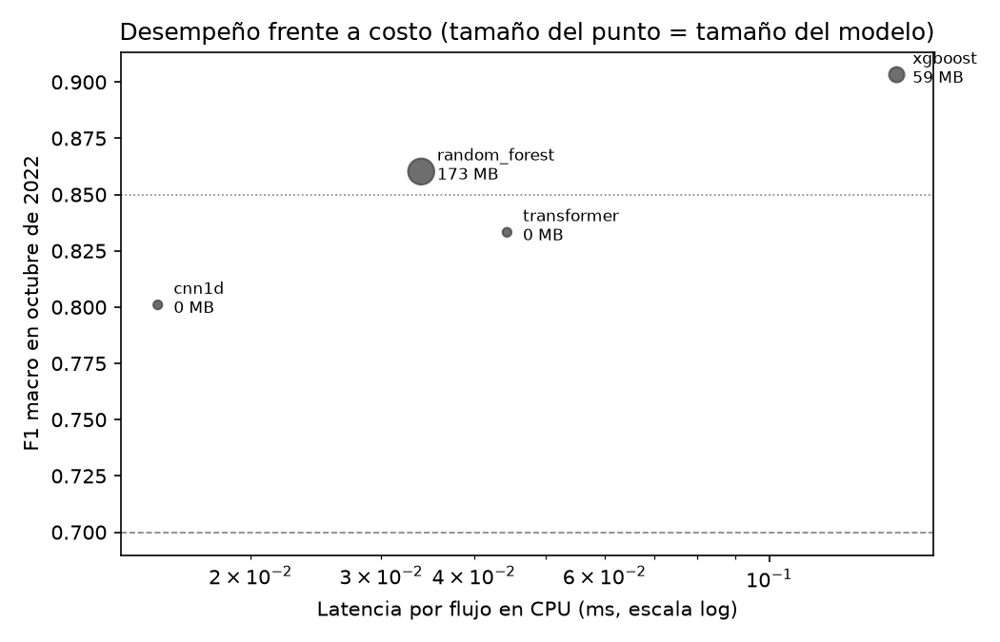
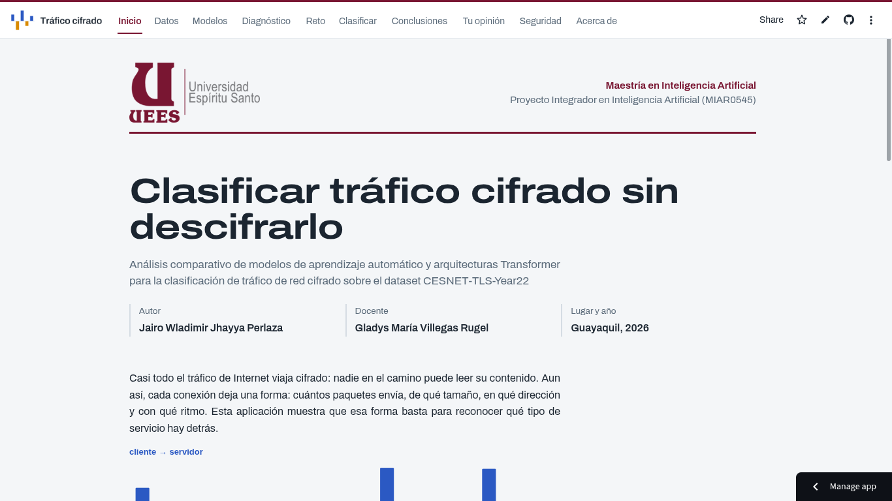
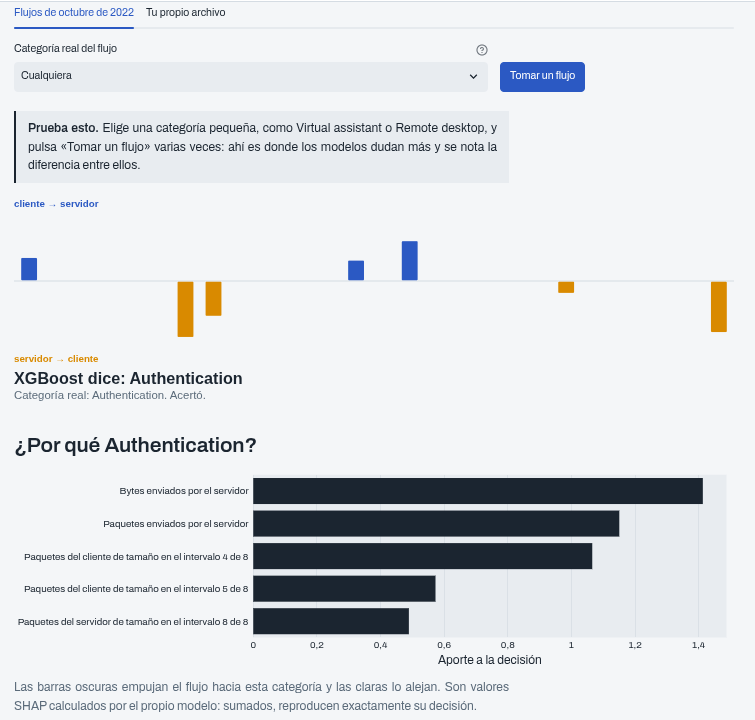
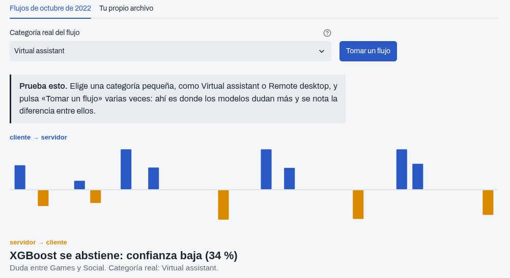
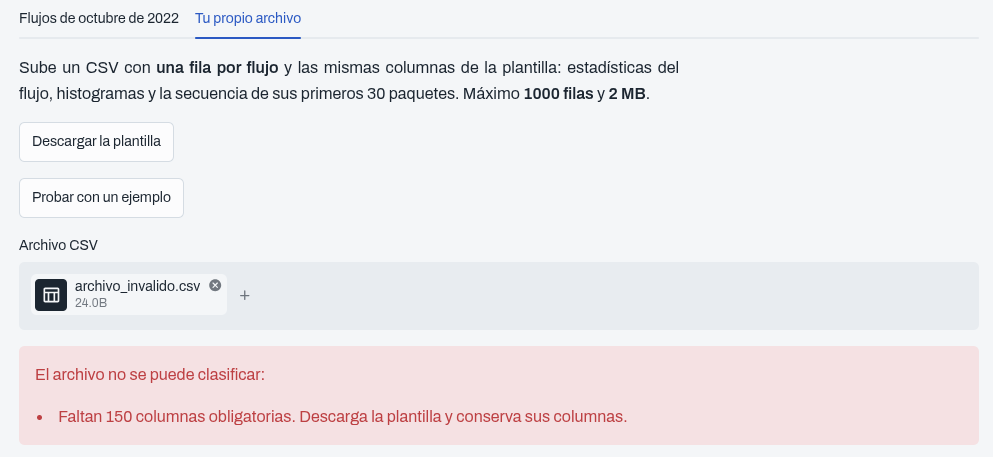

# Clasificación de tráfico de red cifrado con aprendizaje automático y Transformers


[](https://trafico-cifrado-uees.streamlit.app)

Este proyecto identifica a qué tipo de servicio pertenece una conexión de Internet cifrada (streaming, banca en línea,
mensajería y 20 categorías más) **sin descifrar su contenido**, usando solo cómo se comportan sus paquetes. Compara
cuatro modelos sobre un año de tráfico real y publica el mejor en una aplicación web que explica cada decisión.

**Proyecto Integrador en Inteligencia Artificial (MIAR0545)** · Maestría en Inteligencia Artificial · Universidad de
Especialidades Espíritu Santo (UEES) · Autor: Jairo Wladimir Jhayya Perlaza · Docente: Gladys María Villegas Rugel

**Aplicación:** https://trafico-cifrado-uees.streamlit.app

## Tabla de contenidos

1. [Descripción del problema](#descripción-del-problema)
2. [Dataset](#dataset)
3. [Metodología](#metodología)
4. [Resultados](#resultados)
5. [Instalación y uso](#instalación-y-uso)
6. [Interfaz de usuario](#interfaz-de-usuario)
7. [Estructura del proyecto](#estructura-del-proyecto)
8. [Consideraciones éticas](#consideraciones-éticas)
9. [Autores y contribuciones](#autores-y-contribuciones)
10. [Licencia](#licencia)
11. [Agradecimientos y referencias](#agradecimientos-y-referencias)
12. [Videos](#videos)

## Descripción del problema

**Qué problema resuelve.** Casi todo el tráfico de Internet viaja cifrado. Eso protege la privacidad, pero deja a los
administradores de red sin forma de saber qué servicios circulan por su infraestructura, algo que necesitan para
planificar su capacidad, detectar anomalías o diagnosticar problemas. Las alternativas tradicionales, inspeccionar o
interceptar el contenido, vulneran la confidencialidad de las comunicaciones.

**Por qué es importante.** Si el contenido no se puede leer, queda observar el comportamiento de cada conexión: cuánto
pesan sus paquetes, en qué dirección van y cada cuánto aparecen. Este proyecto demuestra que esa información basta para
reconocer el tipo de servicio con alta precisión, y compara con rigor un enfoque clásico y uno basado en atención.

**Usuarios objetivo.** Administradores de redes universitarias y de proveedores de Internet, equipos de operaciones de
seguridad y la comunidad académica.

## Dataset

| Aspecto | Detalle |
|---|---|
| Nombre | **CESNET-TLS-Year22** (Hynek et al., 2024): todo el tráfico TLS de 2022 en la red académica de la República Checa |
| Fuente y licencia | [Zenodo, DOI 10.5281/zenodo.10608607](https://doi.org/10.5281/zenodo.10608607), licencia **CC BY 4.0** |
| Tamaño original | 28,4 GB; 507 millones de flujos; 23 categorías de servicio |
| Muestra del proyecto | 2 % de septiembre a diciembre de 2022: **3 133 138 flujos** |
| Partición | Temporal: septiembre para entrenar (80 %) y validar (20 %), octubre para la prueba, noviembre y diciembre para medir la deriva |
| Variables | 60 variables por flujo (estadísticas, banderas TCP, motivo de cierre e histogramas) y la secuencia de sus primeros 30 paquetes |
| Excluidas | Direcciones IP, nombre del servidor y huella del cliente (privacidad), y el ASN de destino (filtraba la respuesta) |

Detalles en [`data/README.md`](data/README.md) y en el [análisis exploratorio](docs/analisis_datos.md).

## Metodología

| Etapa | Decisión |
|---|---|
| **Modelos** | Dos familias: Random Forest y **XGBoost** sobre las 60 variables, y una CNN 1D y un Transformer sobre la secuencia de paquetes. XGBoost fue el elegido por su precisión, su equidad entre categorías y su velocidad |
| **Preprocesamiento** | Exclusión de identificadores y de la variable con fuga; log10(1 + x) en seis variables muy asimétricas; máscara de relleno para el Transformer; pesos por clase por un desbalance de 145 a 1 |
| **Optimización** | Diagnóstico de subajuste con curvas de aprendizaje (semana 3) y búsqueda bayesiana con Optuna, validación cruzada agrupada y análisis de sensibilidad (semana 5) |
| **Métricas** | F1 macro (pesa igual a las 23 categorías), F1 de la peor categoría, F1 sin secuencias repetidas, deriva mensual, calibración, latencia, y las pruebas de McNemar y Wilcoxon |

Detalles en [`docs/arquitectura.md`](docs/arquitectura.md) y [`docs/optimizacion.md`](docs/optimizacion.md).

## Resultados

| Modelo | F1 macro (octubre) | F1 sin repetidos | F1 en diciembre | Tiempo por flujo | Tamaño |
|---|---|---|---|---|---|
| Clasificador al azar (baseline) | 0,044 | | | | |
| **XGBoost (recomendado)** | **0,903** | 0,885 | 0,856 | 0,149 ms | 58,9 MB |
| XGBoost optimizado con Optuna | **0,911** | | | 0,115 ms* | 154 MB |
| Random Forest | 0,860 | 0,833 | 0,817 | 0,034 ms | 173 MB |
| Transformer | 0,833 | 0,836 | 0,773 | 0,044 ms | 0,3 MB |
| CNN 1D | 0,801 | 0,789 | 0,748 | 0,015 ms | 0,12 MB |

\* Medido en otra sesión del mismo equipo; la versión 2 marcó 0,073 ms en esa misma medición.

- **Frente al baseline:** XGBoost supera al clasificador al azar por más de 85 puntos de F1 macro.
- **Diferencias reales:** los seis pares de modelos difieren con significancia estadística (McNemar con corrección de Holm).
- **Optimización:** la configuración de Optuna mejora a la versión 2 en 0,78 puntos en octubre (IC 95 % de +0,71 a
  +0,85; Wilcoxon p = 0,0015). Pesa 154 MB y supera el límite de GitHub, así que se publica como archivo adjunto de la
  versión 1.0, y la aplicación usa la versión 2.
- **Equidad:** la peor categoría de XGBoost es Media, con F1 de 0,830.



Todas las métricas y figuras están en [`results/`](results/) y en los notebooks [`03_modelado`](notebooks/03_modelado.ipynb)
y [`05_evaluacion`](notebooks/05_evaluacion.ipynb).

## Instalación y uso

**Requisitos:** Linux (probado en Kali), Python 3.13, unos 16 GB de RAM y 40 GB libres de disco para el dataset. No
requiere GPU.

```bash
# 1. Clonar el repositorio
git clone https://github.com/jairowjp/cesnet-tls-classification.git
cd cesnet-tls-classification

# 2. Entorno con Python 3.13 (uv descarga esa versión sin tocar el Python del sistema)
uv python install 3.13
uv venv --python 3.13 ../.venv && source ../.venv/bin/activate
uv pip install -r requirements-lock.txt

# 3. Dataset oficial desde Zenodo (28,4 GB) y verificación de integridad
mkdir -p datasets && cd datasets
wget -c "https://zenodo.org/records/10608607/files/CESNET-TLS-Year22.zip?download=1" -O CESNET-TLS-Year22.zip
wget "https://zenodo.org/records/10608607/files/servicemap.csv?download=1" -O servicemap.csv
md5sum CESNET-TLS-Year22.zip        # debe dar d0dd7c84e2140bba362f6bd23de5cab7
cd ..

# 4. Muestra, pruebas y modelos
python scripts/01_extraer_muestra.py --zip datasets/CESNET-TLS-Year22.zip
python -m pytest -q
python scripts/03_entrenar_clasicos.py --modelo xgboost         # y random_forest
python scripts/05_entrenar_profundos.py --modelo transformer    # y cnn1d
python scripts/04_comparar_modelos.py
```

**Ejemplo de uso del modelo publicado** (sin descargar el dataset):

```python
import pandas as pd
from src.data_processing import variables_tabulares
from src.model import cargar_mejor_modelo

paquete = cargar_mejor_modelo()                      # models/best_model.pkl
flujos = pd.read_csv("data/samples/ejemplo_clasificador.csv")
probabilidades = paquete["modelo"].predict_proba(variables_tabulares(flujos))
print([paquete["clases"][i] for i in probabilidades.argmax(axis=1)])
```

**Aplicación en tu equipo:** `streamlit run app/app.py` (o `bash scripts/utilidades/04_ejecutar_app_local.sh`) y abre
http://localhost:8501. El orden completo de los scripts está en [`scripts/README.md`](scripts/README.md).

## Interfaz de usuario

La aplicación web tiene diez páginas: Inicio, Datos, Modelos, Diagnóstico, Reto, **Clasificar**, Conclusiones, Tu
opinión, Seguridad y **Acerca de**. En **Clasificar** se puede tomar un flujo real de octubre o subir un CSV propio
(con un botón para probar con un ejemplo). Cada clasificación muestra la firma del flujo, la categoría elegida, su
confianza y **las cinco variables que más pesaron**; si la confianza es menor que 45 %, el modelo se abstiene.

**Aplicación:** https://trafico-cifrado-uees.streamlit.app · **Guía completa:** [`docs/manual_usuario.md`](docs/manual_usuario.md)

| Inicio | Clasificar un flujo |
|---|---|
|  |  |
| **El modelo se abstiene cuando duda** | **Validación de un archivo con errores** |
|  |  |

## Estructura del proyecto

| Carpeta | Contenido |
|---|---|
| `docs/` | Planificación, análisis de datos, arquitectura, optimización, consideraciones éticas, manual de usuario, ficha del modelo, uso responsable y los informes de cada semana |
| `data/` | Muestra pública para la app (`samples/`) e instrucciones para obtener los datos (`raw/` y `processed/`) |
| `notebooks/` | Del `01_exploracion` al `05_evaluacion`; los de las actividades semanales están en `actividades/` |
| `src/` | Procesamiento de datos, modelos, entrenamiento y optimización, evaluación y utilidades |
| `models/` | El modelo recomendado (`best_model.pkl`) y la versión 1 (`model_v1.pkl`), con sus huellas SHA-256 |
| `app/` | La aplicación web (`app.py`, sus páginas y su lógica) |
| `tests/` | 103 pruebas automáticas |
| `results/` | Figuras (`figures/`), métricas (`metrics/`) e informes (`reports/`), más los resultados detallados de cada etapa |
| `scripts/` | Los pasos ejecutables, numerados en orden |
| `configs/` | Todos los hiperparámetros y decisiones, en `experiment.yaml` |

## Consideraciones éticas

- **Privacidad:** solo se usan metadatos; nunca se lee el contenido cifrado, y se excluyen las direcciones IP, el
  nombre del servidor y la huella del cliente.
- **Mitigaciones implementadas:** abstención cuando el modelo duda (en validación, el acierto sube de 91,3 % a 94,6 %),
  explicación de cada decisión con valores SHAP y el F1 de la peor categoría reportado junto al promedio.
- **Limitaciones conocidas:** aprendió del tráfico checo de 2022; pierde unos 4,7 puntos en dos meses; confunde servicios
  que comparten infraestructura; y el relleno deliberado de paquetes lo vuelve inútil.
- **Uso inadecuado:** está prohibido usarlo para vigilar o perfilar personas, para priorizar o degradar servicios con
  fines comerciales o para tomar decisiones automáticas sin revisión humana.

Análisis completo en [`docs/consideraciones_eticas.md`](docs/consideraciones_eticas.md), con la
[ficha del modelo](docs/ficha_del_modelo.md) y la [declaración de uso responsable](docs/uso_responsable.md).

## Autores y contribuciones

| Integrante | Rol |
|---|---|
| **Jairo Wladimir Jhayya Perlaza** | Proyecto individual: planificación, ingeniería de datos, modelado, evaluación, desarrollo de la aplicación, análisis ético y documentación |
| Gladys María Villegas Rugel | Docente: revisión de cada sprint y retroalimentación |

## Licencia

El código y el modelo se publican con licencia **MIT** (ver [`LICENSE`](LICENSE)). El dataset CESNET-TLS-Year22 es
© CESNET y tiene licencia **CC BY 4.0**.

## Agradecimientos y referencias

A CESNET por publicar el dataset, y a la docente por su acompañamiento durante el proyecto.

- Akiba, T., Sano, S., Yanase, T., Ohta, T., y Koyama, M. (2019). Optuna: A next-generation hyperparameter optimization
  framework. *KDD '19*, 2623-2631. https://doi.org/10.1145/3292500.3330701
- Chen, T., y Guestrin, C. (2016). XGBoost: A scalable tree boosting system. *KDD '16*, 785-794.
  https://doi.org/10.1145/2939672.2939785
- Hynek, K., Luxemburk, J., Pešek, J., Čejka, T., y Šiška, P. (2024). CESNET-TLS-Year22: A year-spanning TLS network
  traffic dataset from backbone lines. *Scientific Data, 11*, 1156. https://doi.org/10.1038/s41597-024-03927-4
- Lundberg, S. M., y Lee, S.-I. (2017). A unified approach to interpreting model predictions. *Advances in Neural
  Information Processing Systems, 30*, 4765-4774.
- Mitchell, M., et al. (2019). Model cards for model reporting. *FAT* '19*, 220-229. https://doi.org/10.1145/3287560.3287596

**Documentos de cada semana del curso:** en [`docs/`](docs/) y reunidos en [`results/reports/`](results/reports/).

## Videos

- **Video pitch (5 minutos):** *enlace pendiente*
- **Video de respuestas a las preguntas:** *enlace pendiente*
