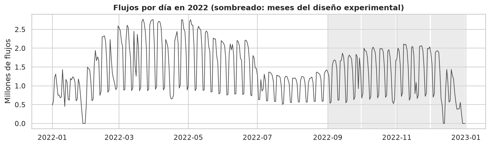
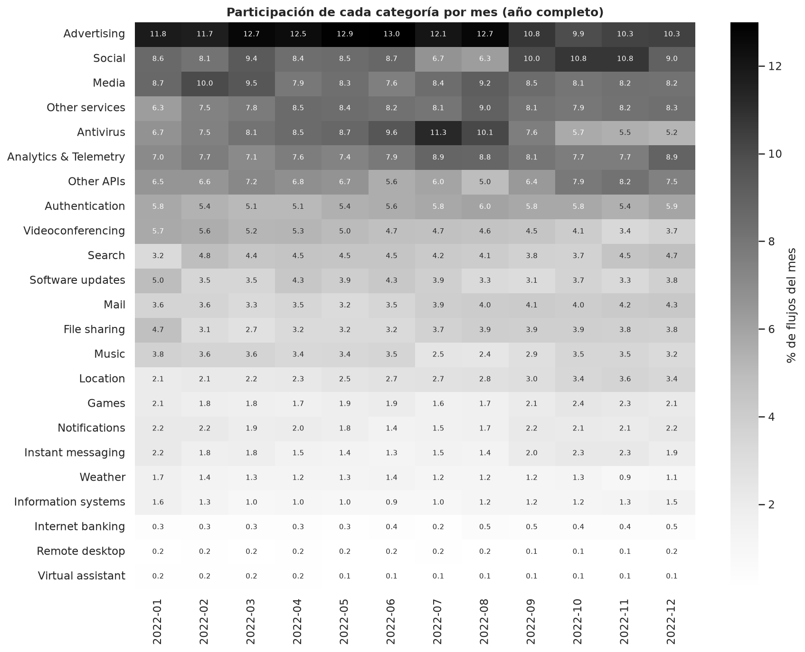
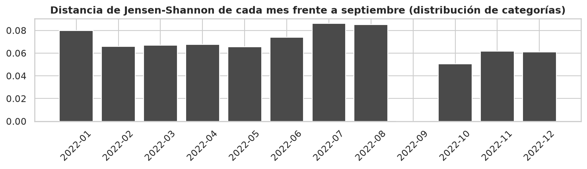
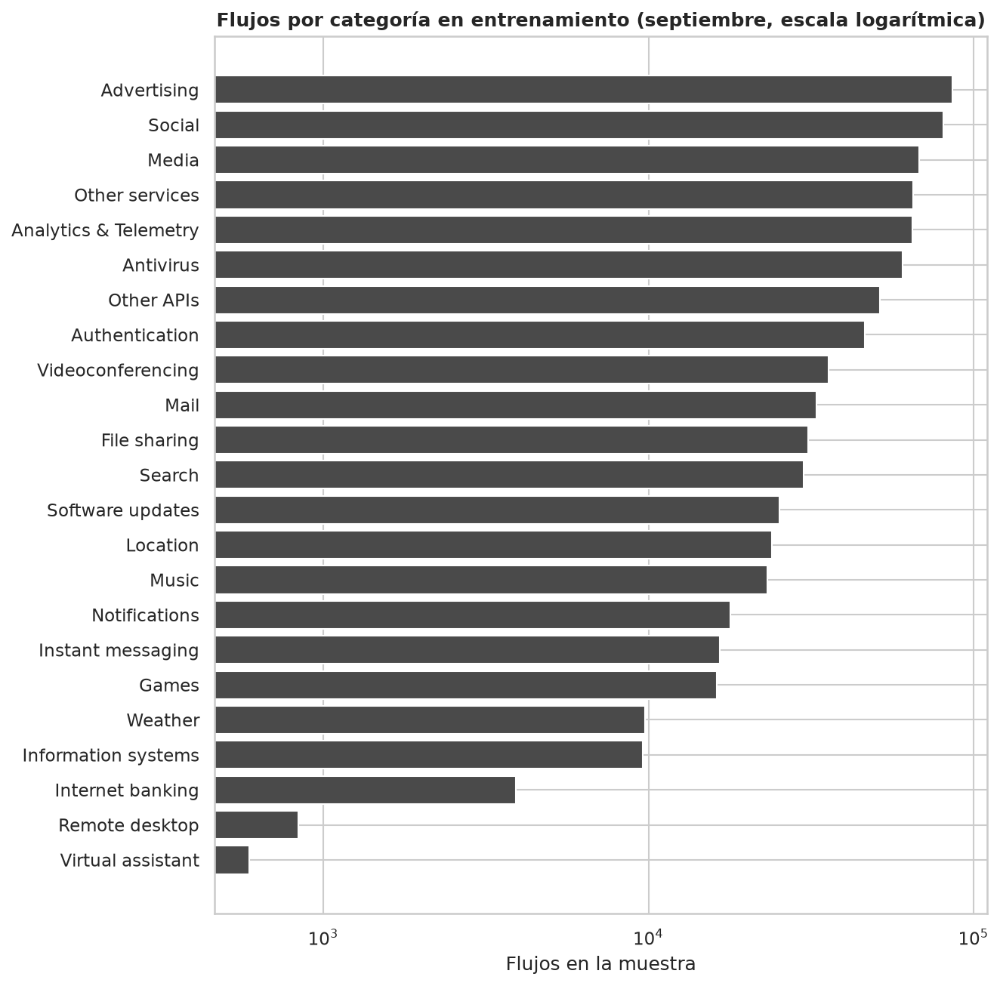
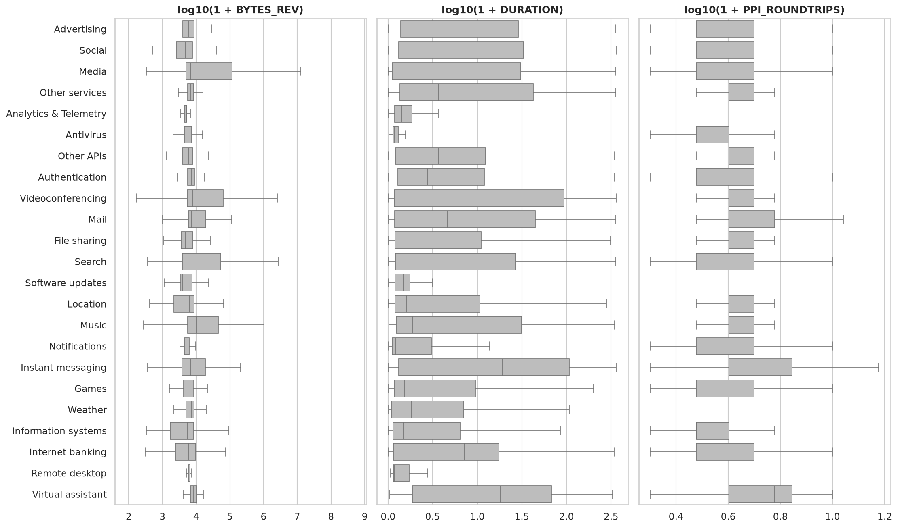
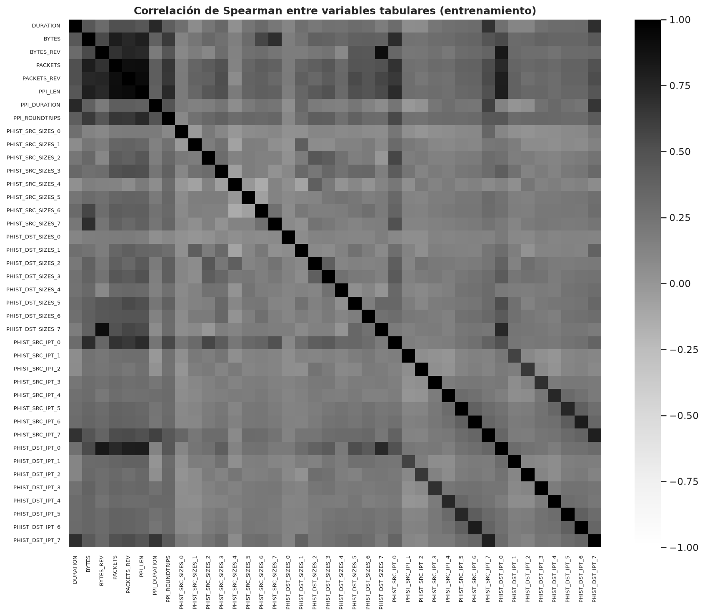
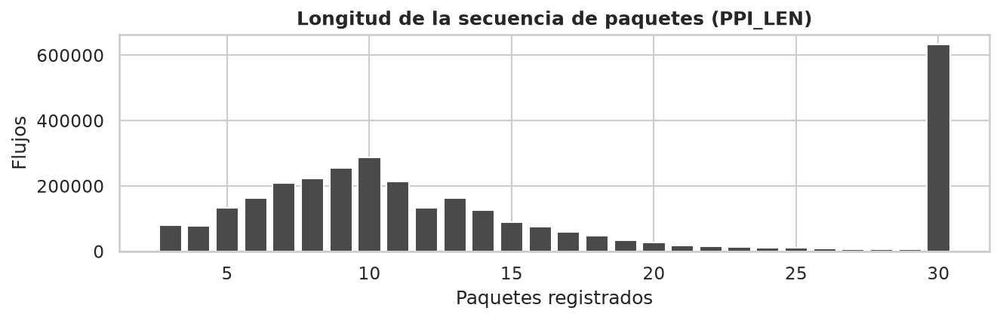
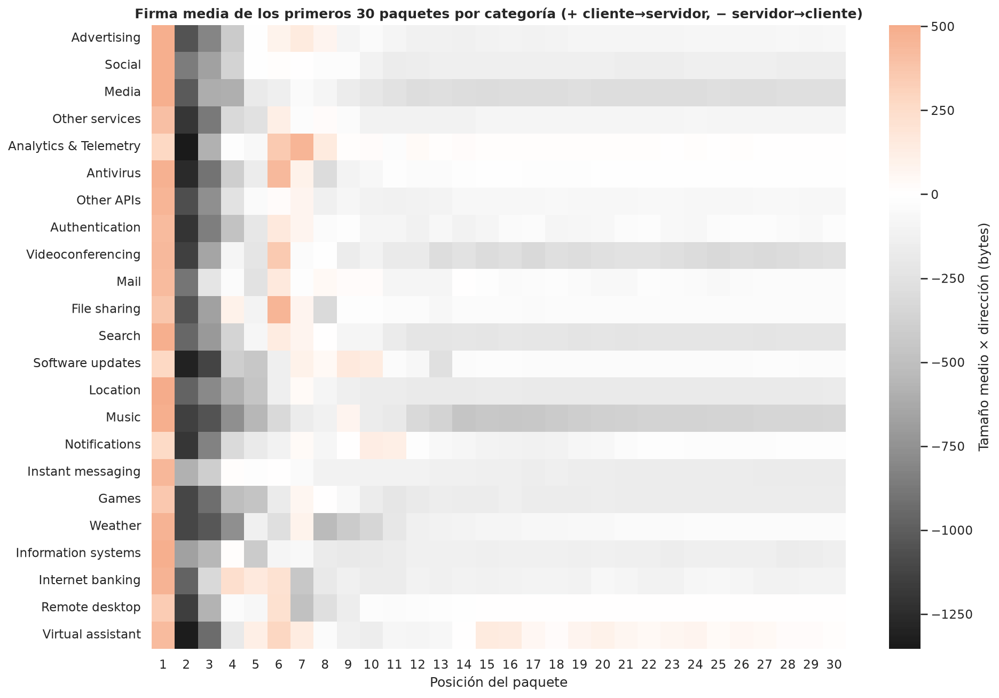

# Análisis exploratorio de los datos

Este documento resume qué datos usa el proyecto, cómo se obtuvieron, qué calidad tienen y qué decisiones de
preprocesamiento se tomaron a partir de ellos. El informe completo está en `docs/semana2/03_eda_cesnet_tls_year22.pdf`,
el análisis reproducible en `notebooks/01_exploracion.ipynb` y la transformación de los datos en
`notebooks/02_preprocesamiento.ipynb`.

## 1. Fuente de los datos

El proyecto usa **CESNET-TLS-Year22** (Hynek et al., 2024), un dataset público con todo el tráfico TLS de 2022 en la red
académica nacional de la República Checa. Cada registro es un flujo, es decir, una conexión cifrada entre un cliente y
un servidor, descrito solo por sus metadatos.

| Elemento | Detalle |
|---|---|
| Origen | Zenodo, DOI 10.5281/zenodo.10608607, licencia CC BY 4.0 |
| Archivo | `CESNET-TLS-Year22.zip`, 28,4 GB, 1 203 archivos organizados por día |
| Integridad | Suma MD5 `d0dd7c84e2140bba362f6bd23de5cab7`, igual a la publicada |
| Volumen del año | 507 739 073 flujos de 180 servicios agrupados en **23 categorías** |
| Columnas por flujo | 45: identificadores, campos TLS, estadísticas, banderas TCP, motivos de cierre, secuencia de los primeros 30 paquetes, histogramas y etiquetas |

La librería oficial de descarga estuvo fuera de servicio durante la preparación, así que el archivo se descargó del
registro de Zenodo y se verificó su suma MD5 antes de usarlo.

## 2. Muestra y partición

Se tomó una muestra aleatoria del **2 %** de los flujos de septiembre a diciembre de 2022, con semilla fija, de modo que
se puede regenerar idéntica con `scripts/01_extraer_muestra.py`. El 2 % es la misma proporción de la submuestra oficial
más pequeña del dataset y cabe con holgura en un equipo de 16 GB de RAM.

| Mes de 2022 | Flujos en el dataset | Flujos en la muestra | Uso |
|---|---|---|---|
| Septiembre | 39 995 390 | 800 128 | Entrenamiento (80 %) y validación (20 %) |
| Octubre | 43 657 026 | 872 731 | Prueba final |
| Noviembre | 46 096 524 | 922 269 | Deriva |
| Diciembre | 26 894 659 | 538 010 | Deriva (cinco días sin datos en el original) |
| **Total** | **156 643 599** | **3 133 138** | |

La partición es **temporal**, no aleatoria: un clasificador de tráfico se entrena con el pasado y se usa en el futuro.
La muestra resultó representativa: la mayor diferencia entre la proporción de cada categoría en la muestra y en todo
septiembre fue de 0,075 puntos porcentuales.

## 3. Panorama del año

*Figura 1. Flujos por día durante 2022. Se ve un ciclo semanal marcado y menos tráfico en las vacaciones académicas;
los meses del experimento tienen un volumen alto y estable.*

*Figura 2. Participación de cada categoría por mes. Las categorías grandes se mantienen estables, pero hay cambios
que justifican medir la deriva.*

*Figura 3. Distancia de Jensen-Shannon de cada mes frente a septiembre. Octubre es el mes más parecido (0,051), y
noviembre y diciembre (0,062 y 0,061) permiten medir cómo envejece el modelo.*

## 4. Calidad de los datos

| Verificación | Resultado |
|---|---|
| Completitud | 100 %: ninguna celda vacía |
| Valores imposibles (duraciones o bytes negativos, tamaños fuera de 0 a 1 500) | Ninguno |
| Coherencia entre la longitud declarada de la secuencia y sus paquetes reales | Total |
| Filas duplicadas exactas | 0,0005 % |

No fue necesario imputar ni descartar flujos. El cuidado del preprocesamiento se concentra en la forma de las variables.

## 5. Distribución de las categorías

*Figura 4. Flujos por categoría en el conjunto de entrenamiento.*

El desbalance es fuerte: la categoría más frecuente, Advertising, tiene 85 927 flujos de entrenamiento (10,74 %), y la
menos frecuente, Virtual assistant, apenas 593 (0,07 %), una razón de **144,9 a 1**. Solo Remote desktop y Virtual
assistant tienen menos de 1 000 flujos. Por eso el proyecto usa el **F1 macro**, que pesa igual a todas las
categorías, y **pesos por clase** inversos a la frecuencia durante el entrenamiento.

## 6. Variables del flujo

| Variable | Mediana | Percentil 99 | Asimetría |
|---|---|---|---|
| Duración (s) | 1,23 | 313 | 3,4 |
| Bytes del cliente al servidor | 2 285 | 151 085 | 485,1 |
| Bytes del servidor al cliente | 5 990 | 3 429 667 | 936,0 |
| Paquetes en la secuencia | 11 | 30 | 0,8 |

Las colas son larguísimas: la mediana de bytes del servidor es de 5 990, pero el máximo supera los 18 000 millones.
Seis de las ocho variables tienen asimetría mayor que 2, y por eso se les aplica **log10(1 + x)**.

*Figura 5. Distribución de tres variables del flujo por categoría, en escala logarítmica. Hay diferencias claras entre
categorías, pero también solapamientos: ninguna variable aislada basta.*

*Figura 6. Correlaciones de Spearman entre las variables tabulares. Solo cuatro pares superan 0,9, todos con una
explicación natural, como el número de paquetes en ambos sentidos.*

## 7. La secuencia de los primeros 30 paquetes

*Figura 7. Longitud de la secuencia. La mediana es de 11 paquetes y el 20,18 % de los flujos llega al tope de 30.*

En conjunto, el **51,62 %** de las posiciones de la secuencia son relleno con ceros. Es un dato decisivo para el
Transformer: sin una máscara de relleno, su mecanismo de atención le daría peso a posiciones vacías.

*Figura 8. Firma media de los primeros 30 paquetes por categoría. Los dos primeros paquetes (el saludo TLS) se parecen
en todas; las diferencias aparecen desde el tercero.*

## 8. Fuga de información y secuencias repetidas

Algunos campos no describen el comportamiento del flujo sino con quién se conecta. La **información mutua
normalizada** del ASN de destino con la categoría es de **0,430**, más de cinco veces la de la variable legítima más
informativa (0,080). Con él, el modelo aprendería a reconocer servidores en lugar de patrones de tráfico, así que se
excluye. El puerto de destino y el protocolo son constantes (443 y TCP en el 100 % de los flujos) y no aportan nada.

| Longitud de la secuencia | Flujos de prueba con una secuencia ya vista en entrenamiento |
|---|---|
| 3 a 5 paquetes | 81,76 % |
| 6 a 10 paquetes | 48,52 % |
| 11 a 20 paquetes | 15,76 % |
| 21 a 30 paquetes | 2,31 % |
| **Total** | **30,33 %** |

Este es probablemente el hallazgo más importante del análisis: casi un tercio de los flujos de prueba repite
exactamente una secuencia de entrenamiento, sobre todo los cortos. Por eso el desempeño se reporta también **sin
secuencias repetidas**, y en la semana 5 la validación cruzada se hizo con **pliegues agrupados por secuencia**.

## 9. Decisiones que salieron del análisis

| Decisión | Evidencia |
|---|---|
| 23 categorías, no 24 como decía el plan inicial | Mapa oficial de servicios y datos |
| Partición temporal: septiembre, octubre, noviembre y diciembre | Diseño experimental y deriva medida |
| Excluir IP, SNI y JA3 | Identifican personas o servicios concretos |
| Excluir el ASN de destino | Fuga de información (NMI de 0,430) |
| log10(1 + x) en seis variables | Asimetría de hasta 936 |
| Máscara de relleno en el Transformer | 51,62 % de posiciones vacías |
| Pesos por clase y F1 macro | Desbalance de 144,9 a 1 |
| F1 también sin secuencias repetidas | 30,33 % de la prueba repite secuencias |

## Referencias

Hynek, K., Luxemburk, J., Pešek, J., Čejka, T., y Šiška, P. (2024). CESNET-TLS-Year22: A year-spanning TLS network
traffic dataset from backbone lines. *Scientific Data, 11*, 1156. https://doi.org/10.1038/s41597-024-03927-4
