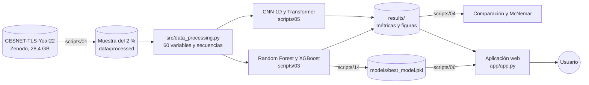
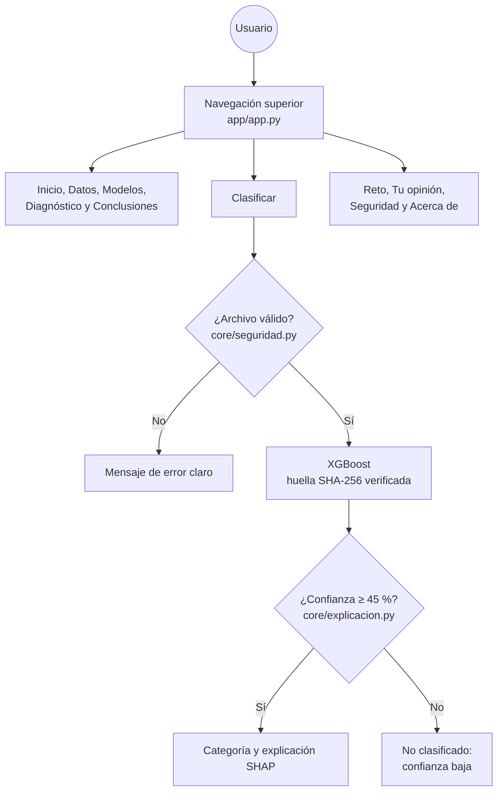

# Arquitectura del sistema

Este documento describe cómo está construido el proyecto: sus componentes, cómo fluyen los datos desde el dataset
original hasta la aplicación web, qué hace cada modelo y qué tecnologías se usan, con sus versiones exactas.

## 1. Vista general

El sistema tiene dos partes que comparten el mismo código de preprocesamiento:

1. **La línea de entrenamiento**, que se ejecuta en el equipo del investigador: extrae la muestra del dataset,
   entrena y evalúa los cuatro modelos, y guarda los resultados y el modelo recomendado.
2. **La aplicación web**, publicada en Streamlit Community Cloud, que usa el modelo recomendado para clasificar flujos
   en vivo y muestra los resultados del estudio.



## 2. Flujo de datos

| Etapa | Entrada | Proceso | Salida |
|---|---|---|---|
| Extracción | El archivo de Zenodo | Muestreo del 2 % con semilla fija, leyendo cada día sin descomprimir en disco | Un archivo parquet por día en `data/processed/` |
| Preprocesamiento | Flujos de la muestra | Exclusión de identificadores y del ASN de destino; log10(1 + x) en seis variables; secuencia de 30 paquetes con máscara | Matrices para cada familia de modelos |
| Entrenamiento | Septiembre (80 %) | Pesos por clase; parada temprana con el 20 % de validación | Modelos entrenados en `models/` |
| Evaluación | Octubre, noviembre y diciembre | Métricas, F1 sin secuencias repetidas, deriva, latencia y McNemar | Tablas y figuras en `results/` |
| Publicación | Modelo recomendado y resultados | Verificación de su huella SHA-256 y copia a la aplicación | `app/models/` y `app/assets/` |
| Uso | Un flujo o un CSV del usuario | Validación, clasificación, abstención y explicación | La categoría, su confianza y sus razones |

## 3. Los modelos

El proyecto compara dos familias que miran el flujo de forma distinta.

| Modelo | Entrada | Arquitectura | Configuración vigente |
|---|---|---|---|
| **Random Forest** | 60 variables tabulares | Bosque de árboles de decisión independientes | 100 árboles, profundidad 20, hojas de 1 flujo |
| **XGBoost** (recomendado) | 60 variables tabulares | Árboles construidos en secuencia, cada uno corrigiendo los errores del anterior | Hasta 1 000 rondas con parada temprana, profundidad 8 y regularización |
| **CNN 1D** | Secuencia de 30 paquetes × 3 valores | Dos capas convolucionales que detectan patrones locales en la secuencia | Canales 64 y 128 |
| **Transformer** | Secuencia de 30 paquetes × 3 valores, con máscara | Codificador de dos capas con atención, que relaciona cada paquete con todos los demás | Dimensión 64, 4 cabezas de atención |

La configuración completa de cada modelo está en `configs/experiment.yaml`, junto con la versión anterior
(`modelos_v1`) para que los resultados sean reproducibles. La justificación de la elección está en la Ficha de
Decisión Técnica (`docs/semana2/01_ficha_decision_tecnica.pdf`) y el proceso de optimización en
`docs/optimizacion.md`.

## 4. Componentes del código

| Carpeta o archivo | Responsabilidad |
|---|---|
| `src/data_processing.py` | Carga de los datos, variables tabulares, secuencias y etiquetas |
| `src/model.py` | Construcción de los modelos y carga verificada del modelo publicado |
| `src/train.py` | Entrenamiento y optimización de hiperparámetros con Optuna |
| `src/evaluate.py` | Métricas, validación cruzada agrupada, pruebas estadísticas, escenarios críticos, errores y equidad |
| `src/utils.py` | Registro de eventos (logging), carga de submuestras y guardado de resultados |
| `src/diagnostico/` | Diagnóstico de sobreajuste y subajuste, con registro en MLflow |
| `scripts/` | Los pasos ejecutables, numerados en el orden en que se usan (ver `scripts/README.md`) |
| `app/` | La aplicación web: `app.py` (navegación), `paginas/` (las diez páginas) y `core/` (datos, seguridad, estilo, abstención y explicaciones) |
| `tests/` | 103 pruebas automáticas del preprocesamiento, los modelos, la evaluación y la aplicación |

## 5. La aplicación web



La aplicación se publica en `https://trafico-cifrado-uees.streamlit.app`. Su punto de entrada es `app/app.py`; el
archivo `app/principal.py` solo existe porque Streamlit Community Cloud no permite cambiar el archivo principal de una
aplicación ya publicada, y se limita a ejecutar `app.py`.

**Seguridad de la aplicación.** Todo CSV pasa por una validación estricta (tamaño, filas, columnas, tipos y rangos)
antes de llegar al modelo; el modelo solo se carga si su huella SHA-256 coincide con la registrada; los errores se
muestran sin detalles internos; y las cabeceras y la configuración siguen las recomendaciones de OWASP. La evidencia
está en `docs/seguridad/` y en la página Seguridad de la aplicación.

## 6. Tecnologías y versiones

**Línea de entrenamiento** (Python 3.13.15; versiones exactas de todo el entorno en `requirements-lock.txt`):

| Uso | Librería | Versión |
|---|---|---|
| Datos | pandas, NumPy, PyArrow | 2.3.3, 2.5.3, 25.0.1 |
| Modelos clásicos | scikit-learn, XGBoost | 1.9.1, 3.4.1 |
| Redes neuronales | PyTorch (variante CPU) | 2.14.0 |
| Estadística | SciPy, statsmodels | 1.18.1, 0.15.0 |
| Optimización | Optuna | 5.0.0 |
| Equidad | Fairlearn | 0.15.0 |
| Seguimiento de experimentos | MLflow | 3.16.1 |
| Gráficos | Matplotlib, seaborn | 3.11.2, 0.13.2 |
| Notebooks | Jupyter, ipykernel | 1.1.1, 7.3.0 |
| Pruebas | pytest | 9.1.1 |

**Aplicación web** (`app/requirements.txt`): Streamlit 1.64.0 y Plotly, con las mismas librerías de datos y XGBoost.
Solo Streamlit tiene versión fija en la aplicación, para no impedir que la plataforma instale versiones compatibles con
su propia versión de Python.

## 7. Cómo reproducir el sistema

```bash
uv venv --python 3.13 && source .venv/bin/activate
uv pip install -r requirements.txt
python scripts/01_extraer_muestra.py                     # muestra del 2 % (requiere el archivo de Zenodo)
python scripts/03_entrenar_clasicos.py --modelo xgboost   # y los demás modelos (ver scripts/README.md)
python scripts/04_comparar_modelos.py
python -m pytest -q
streamlit run app/app.py
```
