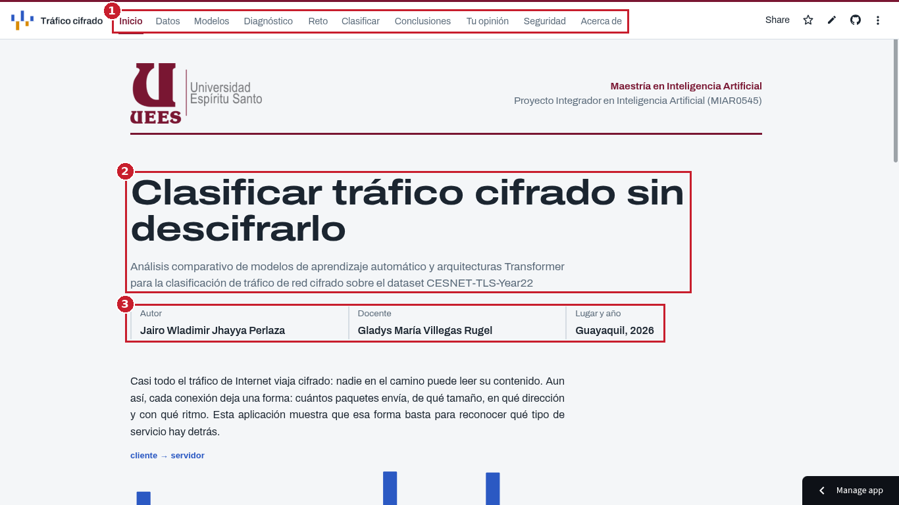
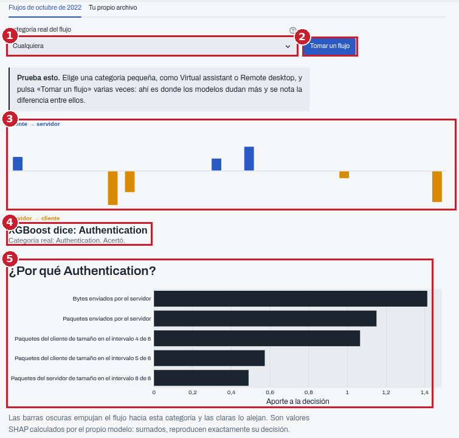
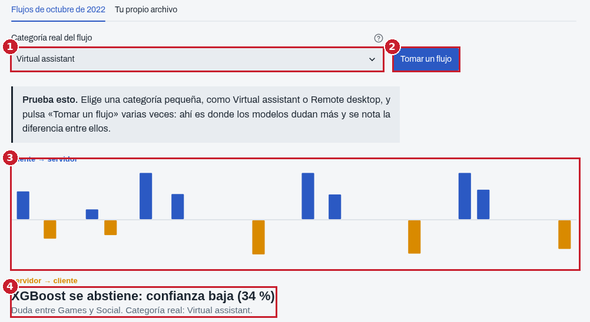
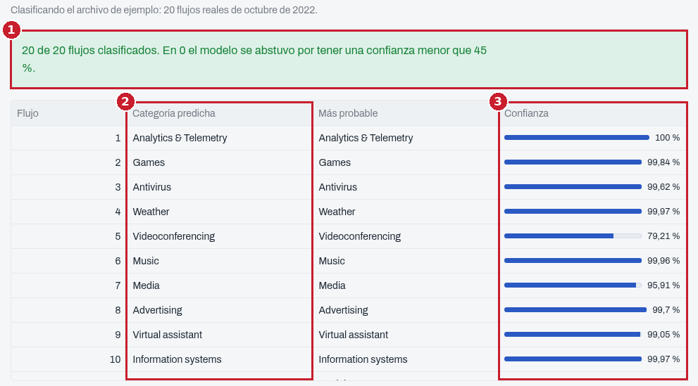
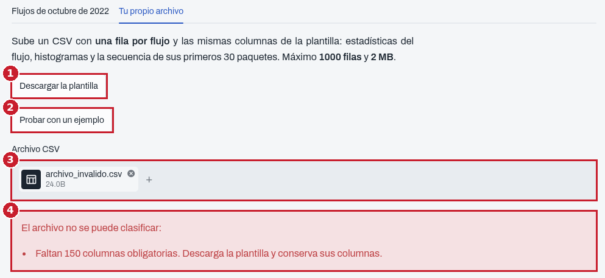
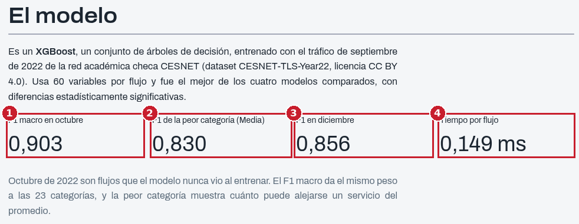

# Manual de usuario

Esta guía explica cómo usar la aplicación web del proyecto, que clasifica conexiones de red cifradas según el tipo de
servicio que hay detrás, sin leer su contenido.

**Dirección de la aplicación:** https://trafico-cifrado-uees.streamlit.app

No requiere instalación ni registro: funciona en cualquier navegador actualizado, en computador o en teléfono.

## 1. Primeros pasos

| Número | Elemento | Para qué sirve |
|---|---|---|
| 1 | **Menú superior** | Lleva a cada una de las diez páginas. La página actual aparece subrayada |
| 2 | **Título y propósito** | Resume qué hace la aplicación |
| 3 | **Autoría** | Autor, docente, lugar y año del proyecto |

Si es tu primera visita, la aplicación puede tardar alrededor de un minuto en abrir: cuando nadie la usa durante un
tiempo, la plataforma la pone en reposo. Si ves un botón para "despertarla", púlsalo y espera.

## 2. Qué hay en cada página

| Página | Qué encontrarás |
|---|---|
| **Inicio** | El problema, la idea central y un flujo de ejemplo clasificado en vivo |
| **Datos** | Qué tráfico se usó, cuánto hay de cada tipo y cómo cambia durante el año |
| **Modelos** | La comparación de los cuatro modelos: precisión, velocidad, tamaño y equidad entre categorías |
| **Diagnóstico** | Las curvas de aprendizaje y cómo se corrigió el subajuste de los modelos |
| **Reto** | Un juego: intenta adivinar la categoría de un flujo antes que los modelos |
| **Clasificar** | La herramienta principal: clasifica flujos reales o tu propio archivo (ver la sección 3) |
| **Conclusiones** | Qué se aprendió y qué modelo se recomienda |
| **Tu opinión** | Una encuesta breve de usabilidad (SUS), con un código de acceso |
| **Seguridad** | Cómo se protege la aplicación |
| **Acerca de** | Qué hace el modelo, sus métricas, sus limitaciones y sus usos prohibidos |

## 3. Clasificar tráfico paso a paso

La página **Clasificar** tiene dos pestañas: **Flujos de octubre de 2022**, para probar el modelo con tráfico real
que nunca vio al entrenar, y **Tu propio archivo**, para clasificar tus propios flujos.

### 3.1 Clasificar un flujo real

| Número | Elemento | Qué hacer o qué significa |
|---|---|---|
| 1 | **Categoría real del flujo** | Elige una categoría o deja "Cualquiera" para un flujo al azar |
| 2 | **Tomar un flujo** | Toma un flujo real de octubre de 2022 y lo clasifica |
| 3 | **Firma del flujo** | Sus primeros paquetes: hacia arriba, del cliente al servidor; hacia abajo, del servidor al cliente. La altura es el tamaño del paquete |
| 4 | **Veredicto** | La categoría que eligió el modelo, la categoría real y si acertó |
| 5 | **¿Por qué esta categoría?** | Las cinco variables que más pesaron en la decisión. Las barras oscuras empujan hacia la categoría elegida y las claras la alejan |

Más abajo, la sección **"Qué dice cada modelo"** compara la respuesta de los cuatro modelos para el mismo flujo.

### 3.2 Cuando el modelo duda: la abstención

| Número | Elemento | Qué significa |
|---|---|---|
| 1 | Categoría elegida | En este ejemplo, Virtual assistant, una de las más difíciles |
| 2 | Tomar un flujo | Púlsalo varias veces para ver distintos flujos |
| 3 | Firma del flujo | Igual que antes |
| 4 | **Abstención** | Si la confianza del modelo es menor que 45 %, **no da una respuesta**: indica entre qué categorías duda |

La abstención es intencional. El modelo prefiere reconocer que no está seguro antes que arriesgar un error. Ocurre en
unos 6 de cada 100 flujos, y gracias a ella el acierto en los flujos que sí clasifica sube de 91,3 % a 94,6 %.

### 3.3 Clasificar tu propio archivo

| Número | Elemento | Qué significa |
|---|---|---|
| 1 | **Resumen** | Cuántos flujos se clasificaron y en cuántos el modelo se abstuvo |
| 2 | **Categoría predicha** | La respuesta del modelo, o "No clasificado: confianza baja" si se abstuvo |
| 3 | **Confianza** | Qué tan seguro está el modelo de su respuesta |

Pasos:

1. Ve a la pestaña **Tu propio archivo**.
2. Si quieres ver cómo funciona, pulsa **Probar con un ejemplo**: carga 20 flujos reales y los clasifica.
3. Para usar tus datos, pulsa **Descargar la plantilla**, llénala con una fila por flujo conservando sus columnas, y
   súbela en **Archivo CSV**.
4. Revisa la tabla de resultados y descárgala con el botón que aparece debajo.

### 3.4 Si el archivo tiene un problema

| Número | Elemento | Para qué sirve |
|---|---|---|
| 1 | **Descargar la plantilla** | Obtienes un archivo con las columnas exactas que necesita el modelo |
| 2 | **Probar con un ejemplo** | Clasifica 20 flujos de ejemplo sin necesidad de un archivo propio |
| 3 | **Archivo CSV** | Donde se sube el archivo |
| 4 | **Mensaje de error** | Explica qué está mal y cómo corregirlo. El archivo no se procesa hasta que sea válido |

## 4. Cómo interpretar los resultados

| Concepto | Qué significa | Cómo usarlo |
|---|---|---|
| **Categoría predicha** | El tipo de servicio más probable | Es una estimación, no una certeza |
| **Confianza** | La probabilidad que el modelo asigna a su respuesta | Por encima de 90 %, el modelo acierta en el 99 % de los casos; entre 45 % y 70 %, conviene revisar |
| **No clasificado: confianza baja** | El modelo se abstuvo | Considera las dos categorías entre las que duda, o revisa el flujo manualmente |
| **¿Por qué…?** | Las variables que más pesaron | Útil para entender la decisión y detectar errores |

| Número | Métrica | Qué significa |
|---|---|---|
| 1 | F1 macro en octubre (0,903) | Su precisión general en tráfico que nunca vio, dando el mismo peso a las 23 categorías |
| 2 | F1 de la peor categoría (0,830, Media) | Cuánto puede alejarse un servicio del promedio |
| 3 | F1 en diciembre (0,856) | Cómo envejece el modelo con el paso de los meses |
| 4 | Tiempo por flujo (0,149 ms) | Su velocidad: miles de flujos por segundo en un procesador común |

## 5. Solución de problemas

| Problema | Causa probable | Solución |
|---|---|---|
| La aplicación tarda en abrir | Estaba en reposo por inactividad | Espera alrededor de un minuto o pulsa el botón para despertarla |
| "Faltan N columnas obligatorias" | El archivo no tiene las columnas de la plantilla | Descarga la plantilla y conserva sus columnas y sus nombres |
| El archivo se rechaza por su tamaño | Tiene más de 1 000 flujos o pesa más de 2 MB | Divide el archivo en varios más pequeños |
| Valores no numéricos o vacíos | Celdas con texto o sin datos | Revisa que todas las celdas tengan números |
| Muchos flujos "No clasificados" | El tráfico es muy distinto del de entrenamiento | Es esperable en redes distintas de la original; considera reentrenar el modelo con datos locales |
| La página muestra un mensaje de error general | Un problema temporal | Recarga la página con Ctrl + Shift + R; si persiste, repórtalo (sección 7) |

## 6. Preguntas frecuentes

**¿La aplicación lee el contenido de mis comunicaciones?**
No. Solo usa metadatos: tamaños, direcciones y tiempos de los paquetes. El contenido cifrado nunca se lee.

**¿Se guardan los archivos que subo?**
No. Se procesan en memoria y se descartan al cerrar la página.

**¿Qué tan confiable es el modelo?**
Acierta en unas 90 de cada 100 conexiones de tráfico que nunca vio. Funciona mejor con servicios de patrones claros,
como notificaciones o actualizaciones, y peor con servicios que comparten infraestructura, como Media y Social.

**¿Puedo usarlo con el tráfico de mi red?**
Puedes probarlo, pero aprendió del tráfico de una red académica checa de 2022. Para usarlo en otra red conviene
reentrenarlo con datos locales.

**¿Para qué no debe usarse?**
Para vigilar o perfilar a personas, para priorizar o degradar servicios con fines comerciales, o para tomar decisiones
automáticas sin revisión humana. Ver la página Acerca de y `docs/uso_responsable.md`.

**¿Por qué a veces el modelo no responde?**
Porque se abstiene cuando su confianza es baja, para no arriesgar un error (sección 3.2).

## 7. Soporte y contacto

- **Reportar un problema o sugerir una mejora:** abre un *issue* en
  https://github.com/jairowjp/cesnet-tls-classification/issues
- **Autor:** Jairo Wladimir Jhayya Perlaza, Maestría en Inteligencia Artificial, Universidad de Especialidades
  Espíritu Santo (UEES).
