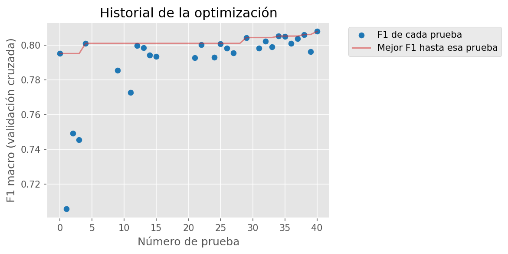
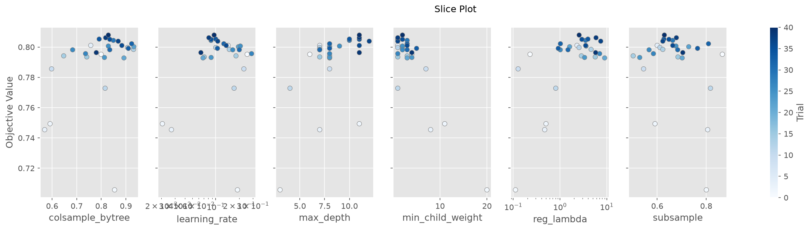
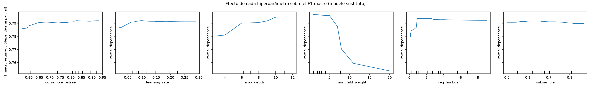
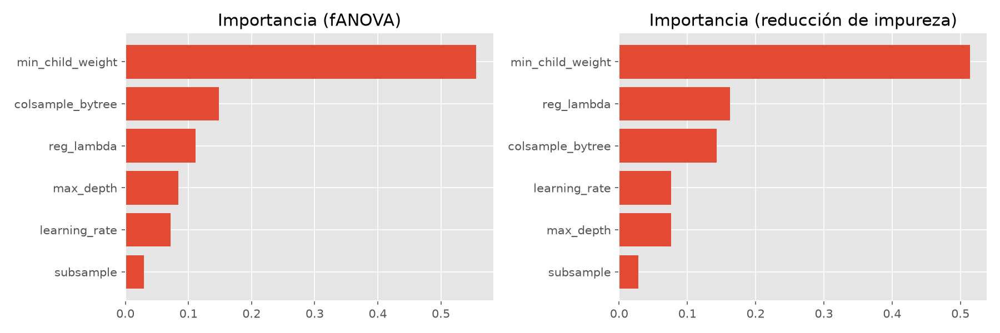
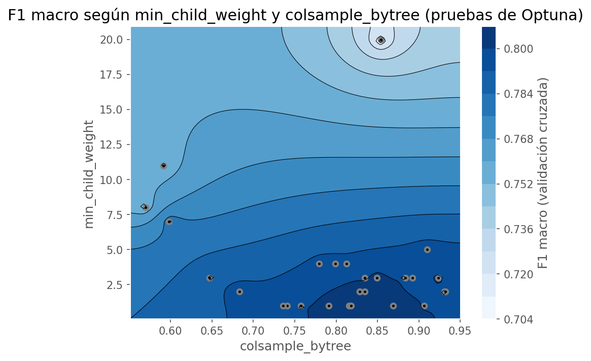
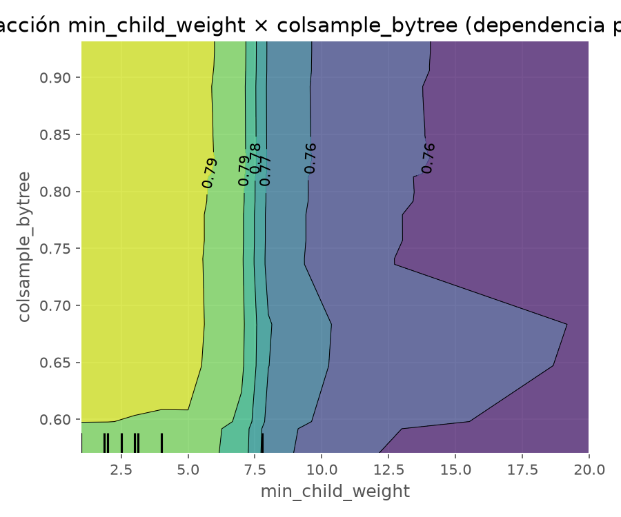
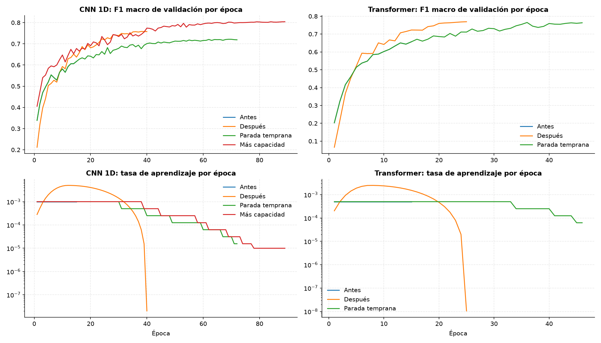

# Optimización de hiperparámetros

Este documento resume cómo se optimizaron los modelos del proyecto. El análisis completo, con todas las tablas y el
código, está en `notebooks/04_optimizacion.ipynb`, en el notebook del workshop
(`notebooks/actividades/Semana5_Workshops_Jairo_Jhayya.ipynb`) y en el informe de la semana 5
(`docs/semana5/Informe_Semana5_Evaluacion_Optimizacion_Jairo_Jhayya.pdf`).

## 1. Proceso de optimización

La optimización se hizo en dos etapas, cada una motivada por un diagnóstico previo.

1. **Semana 3: diagnóstico y versión 2.** Las curvas de aprendizaje mostraron que los cuatro modelos estaban en
   **subajuste**: no terminaban de aprender. A partir de ese diagnóstico se ajustó la configuración de cada uno, y la
   versión 2 solo reemplazó a la versión 1 si mejoraba el F1 de validación. Los cuatro mejoraron, entre 1,7 y 10,1
   puntos en la prueba.
2. **Semana 5: búsqueda sistemática con Optuna.** Sobre XGBoost, el modelo recomendado, se hizo una búsqueda
   bayesiana con Optuna (Akiba et al., 2019) y su muestreador TPE (Bergstra et al., 2011), con semilla fija.

En la semana 5, cada configuración se evaluó con **validación cruzada agrupada de tres pliegues** sobre una submuestra
estratificada de 60 000 flujos de septiembre. Los pliegues se agruparon por secuencia de paquetes, porque el 30,3 % de
las secuencias se repite y una validación aleatoria habría sobrestimado el desempeño. Las configuraciones que iban
claramente peor que la mediana se abandonaban tras el primer pliegue. El estudio tenía un tope de 4,5 horas y alcanzó
**41 pruebas**: 28 completas y 13 abandonadas. Todos los criterios se fijaron antes de ejecutar, en `configs/experiment.yaml`.

*Figura 1. Historial de la búsqueda. El mejor F1 se mantuvo en 0,8011 desde la prueba 4 hasta la 28 y mejoró cuatro
veces a partir de la 29, hasta 0,8079 en la prueba 40.*

## 2. Hiperparámetros explorados y rangos

| Hiperparámetro | Qué controla | Rango explorado | Escala |
|---|---|---|---|
| `max_depth` | Profundidad máxima de cada árbol | 3 a 12 | Lineal |
| `learning_rate` | Cuánto corrige cada árbol los errores del anterior | 0,01 a 0,30 | Logarítmica |
| `subsample` | Fracción de flujos que ve cada árbol | 0,5 a 1,0 | Lineal |
| `colsample_bytree` | Fracción de variables que ve cada árbol | 0,5 a 1,0 | Lineal |
| `reg_lambda` | Regularización L2 de los pesos | 0,1 a 20 | Logarítmica |
| `min_child_weight` | Peso mínimo de flujos para crear una hoja | 1 a 20 | Lineal |

Cada prueba usó hasta 400 rondas con parada temprana tras 30 rondas sin mejora. Los rangos incluyen los valores de la
versión 2, para poder compararlos.

## 3. Resultados del análisis de sensibilidad

Entre la peor y la mejor prueba completa hay **10 puntos de F1 macro** (de 0,706 a 0,808): la elección de
hiperparámetros importa mucho. Entre las cinco mejores, en cambio, la diferencia es de apenas 0,4 puntos. Equivocarse
en el hiperparámetro dominante cuesta caro; afinar el resto aporta poco.

*Figura 2. F1 macro de cada prueba según el valor de cada hiperparámetro.*

## 4. Gráficos de dependencia parcial

La dependencia parcial muestra cómo cambia el F1 al mover un hiperparámetro mientras los demás se promedian. Se
calculó con un modelo sustituto (un bosque aleatorio entrenado sobre las 28 pruebas completas).

*Figura 3. Dependencia parcial del F1 macro respecto de cada hiperparámetro.*

| Hiperparámetro | Efecto observado |
|---|---|
| `min_child_weight` | El F1 se mantiene alto hasta 5 y cae con fuerza a partir de 6 |
| `max_depth` | El F1 sube con la profundidad y **sigue subiendo en el borde superior** (12) |
| `learning_rate` | Sube hasta cerca de 0,10 y luego se estabiliza |
| `reg_lambda` | Valores muy bajos (menos de 0,5) empeoran; por encima, efecto casi plano |
| `colsample_bytree` y `subsample` | Efecto pequeño en todo el rango |

## 5. Ranking de importancia de hiperparámetros

La importancia se midió con dos métodos distintos: fANOVA (Hutter et al., 2014) y la reducción de impureza de un
bosque aleatorio. Si coinciden, la conclusión no depende del método.

| Hiperparámetro | fANOVA | Reducción de impureza |
|---|---|---|
| `min_child_weight` | **55,6 %** | **51,4 %** |
| `colsample_bytree` | 14,8 % | 14,3 % |
| `reg_lambda` | 11,1 % | 16,3 % |
| `max_depth` | 8,4 % | 7,6 % |
| `learning_rate` | 7,1 % | 7,6 % |
| `subsample` | 2,9 % | 2,8 % |

*Figura 4. Importancia de cada hiperparámetro según los dos métodos.*

Los dos métodos coinciden en el más importante, `min_child_weight`, que explica más de la mitad de la variación, y en
el menos importante, `subsample`. En el medio cambian el orden de `colsample_bytree` y `reg_lambda`.

## 6. Análisis de interacciones

*Figura 5. F1 macro de las pruebas según los dos hiperparámetros más importantes.*

*Figura 6. Dependencia parcial conjunta de min_child_weight y colsample_bytree.*

No hay una interacción relevante entre los dos hiperparámetros más importantes. En la dependencia parcial conjunta las
franjas de color son verticales: el F1 cambia al mover `min_child_weight` y casi no cambia al mover `colsample_bytree`.
Solo por debajo de 0,6 en `colsample_bytree` el F1 baja algo más. Esto significa que ambos pueden ajustarse por
separado.

## 7. Configuración final seleccionada y justificación

| Hiperparámetro | Versión 2 | Optimizada | Justificación |
|---|---|---|---|
| `min_child_weight` | 5 | **2** | Valores bajos permiten hojas más específicas, necesarias para las categorías pequeñas |
| `max_depth` | 8 | **11** | Árboles más profundos captan interacciones entre variables; coherente con el subajuste detectado |
| `reg_lambda` | 5,0 | **2,6** | Menos regularización, por la misma razón |
| `learning_rate` | 0,100 | **0,095** | Prácticamente igual |
| `colsample_bytree` | 0,80 | **0,83** | Prácticamente igual |
| `subsample` | 0,80 | **0,63** | Poco importante; el valor elegido introduce algo más de aleatoriedad |

La configuración optimizada es **más compleja** que la versión 2, lo que confirma el diagnóstico de la semana 3: el
modelo tendía al subajuste, no al sobreajuste.

**Decisión de publicación.** El modelo optimizado, reentrenado con todo septiembre, pesa **154 MB**, y GitHub no admite
archivos de más de 100 MB. Su velocidad no es problema (0,115 ms por flujo frente a 0,073 ms de la versión 2, medidos
en el mismo equipo). Por eso la aplicación y `models/best_model.pkl` mantienen la versión 2, y el modelo optimizado se
publica como archivo adjunto de la versión 1.0 del repositorio.

## 8. Comparación antes y después de la optimización

Una configuración con mejor F1 en una búsqueda no basta: la mejora se verificó en tres conjuntos de datos distintos.

| Prueba | Datos | Versión 2 | Optimizada | Resultado |
|---|---|---|---|---|
| Wilcoxon pareada (Wilcoxon, 1945) | 15 pliegues de la validación cruzada 5 × 3 | 0,808 | 0,812 | Mediana +0,39 puntos; p = 0,0015 |
| Validación | 160 026 flujos de septiembre | 0,916 | 0,924 | +0,79 puntos |
| Prueba final | 872 731 flujos de octubre | 0,903 | 0,911 | +0,78 puntos; IC 95 % [+0,71; +0,85] |
| McNemar (McNemar, 1947) | Los mismos flujos de octubre | 9 431 aciertos exclusivos | 16 246 aciertos exclusivos | p < 0,001 |

La mejora es pequeña en magnitud pero real: aparece en los tres conjuntos y en ninguno se explica por el azar. Que la
mejora en validación y en octubre sea casi idéntica indica que la configuración no se ajustó en exceso a los datos con
los que se eligió. En octubre, la peor categoría (Media) también sube, de 0,830 a 0,840.

### Las redes neuronales

En la semana 3 la docente observó que la parada temprana de las redes nunca se activaba. La causa era doble: el
programador OneCycle fijaba la duración del entrenamiento, y la paciencia se reiniciaba con cualquier mejora mínima. Se
corrigió con ReduceLROnPlateau (Prechelt, 1998), una mejora mínima de 0,001 y un límite alto de épocas.

| Red y variante | Épocas | Parada activada | F1 validación | F1 octubre |
|---|---|---|---|---|
| CNN 1D, semana 3 | 40 de 40 | No | 0,758 | 0,746 |
| CNN 1D, parada temprana | 72 de 150 | Sí | 0,719 | 0,713 |
| CNN 1D, más capacidad | 89 de 150 | Sí | **0,804** | **0,791** |
| Transformer, semana 3 | 25 de 25 | No | 0,769 | 0,757 |
| Transformer, parada temprana | 46 de 100 | Sí | 0,763 | 0,753 |

*Figura 7. F1 macro de validación y tasa de aprendizaje por época de cada variante.*

La parada temprana ahora actúa, pero entrenar más no mejoró las redes: su F1 de entrenamiento siguió por debajo de
0,80. **El límite era la capacidad.** La CNN con el doble de canales ganó 4,5 puntos en octubre.

## 9. Limitaciones

1. La búsqueda alcanzó 41 de las 60 pruebas previstas, y su límite de 400 rondas fue corto: la mejor prueba usó en
   promedio 395.
2. Los mejores valores de `min_child_weight` y `max_depth` quedaron en los bordes del rango; una nueva búsqueda debería
   ampliarlo.
3. En la validación cruzada, la optimización mejoró el promedio pero no la peor categoría.
4. El Transformer con más capacidad quedó sin evaluar.

## Referencias

Akiba, T., Sano, S., Yanase, T., Ohta, T., y Koyama, M. (2019). Optuna: A next-generation hyperparameter optimization
framework. En *Proceedings of the 25th ACM SIGKDD International Conference on Knowledge Discovery & Data Mining*
(pp. 2623-2631). ACM. https://doi.org/10.1145/3292500.3330701

Bergstra, J., Bardenet, R., Bengio, Y., y Kégl, B. (2011). Algorithms for hyper-parameter optimization. En *Advances in
Neural Information Processing Systems* (Vol. 24, pp. 2546-2554). Curran Associates.

Hutter, F., Hoos, H., y Leyton-Brown, K. (2014). An efficient approach for assessing hyperparameter importance. En
*Proceedings of the 31st International Conference on Machine Learning* (pp. 754-762). PMLR.

McNemar, Q. (1947). Note on the sampling error of the difference between correlated proportions or percentages.
*Psychometrika, 12*(2), 153-157. https://doi.org/10.1007/BF02295996

Prechelt, L. (1998). Early stopping: But when? En G. B. Orr y K.-R. Müller (Eds.), *Neural networks: Tricks of the
trade* (pp. 55-69). Springer.

Wilcoxon, F. (1945). Individual comparisons by ranking methods. *Biometrics Bulletin, 1*(6), 80-83.
https://doi.org/10.2307/3001968
